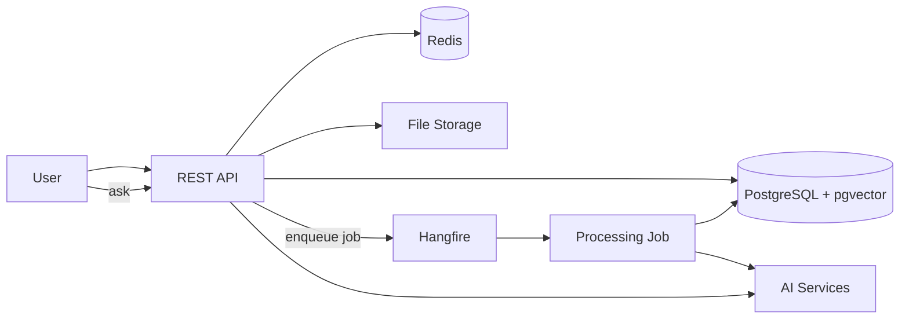

<h1 align="center">ManualMate</h1>

<p align="center">
  
  <br><br>
  
  
  
  
</p>

<p align="center">
  <strong>PDF Manuals Q&A with RAG</strong><br>
  Upload a PDF manual, it gets processed in the background with Hangfire, then you can ask questions about it.
  Built with .NET 10, PostgreSQL (pgvector), Redis, Voyage AI, Gemini, and a React frontend.
</p>

---

## How it works



Two flows:

* **Upload (background):** save item + PDF → enqueue Hangfire job → job extracts the text, chunks it, generates embeddings, and stores them in pgvector
* **Ask (real time):** check Redis → on miss, embed the question → find the top chunks in pgvector → Gemini writes the answer → answer gets cached

More detail: [docs/system-design.md](docs/system-design.md)

---

## Features

* **Background processing with Hangfire:** uploaded manuals are processed by a background job instead of blocking the HTTP request. Jobs are stored in PostgreSQL, so there is no message broker to install or run.
* **RAG Q&A:** answers come from the manual's own content, using vector similarity search plus Gemini.
* **Vector search with pgvector:** embeddings live in PostgreSQL and are searched with cosine distance through an HNSW index, right inside the database.
* **Voyage AI embeddings:** manual chunks and questions are turned into 512-dimension vectors with `voyage-3.5-lite`.
* **PDF extraction with PdfPig:** text is pulled out of the PDF and split into ~1000 character chunks with 150 characters of overlap.
* **Redis caching:** repeated questions are answered from cache (24h TTL). The cache key includes the item's last-updated time, so replacing a manual invalidates old answers.
* **Item status tracking:** every item goes through `Pending → Processing → Completed / Failed`. Q&A only answers once a manual is `Completed`.
* **React frontend:** upload manuals and chat with them from a simple UI.
* **Hangfire dashboard:** watch job state at `/hangfire`.

---

## Background processing

When a manual is uploaded, the API saves the item and the PDF, enqueues a Hangfire job, and returns immediately. The job does the slow work on its own.

### Manual processing flow

```text
Client
  │
  │ Upload Manual
  ▼
API
  │
  │ 1. Save Item + PDF
  │ 2. Enqueue Job (item ID)
  │ 3. Return Response
  ▼
Hangfire (jobs stored in PostgreSQL)
  │
  ▼
ItemProcessingJob
  │
  ├── Status → Processing
  ├── Extract PDF Text (PdfPig)
  ├── Split Text into Chunks
  ├── Generate Embeddings (Voyage AI)
  ├── Store Chunks + Embeddings
  └── Status → Completed
              │
              ▼
        PostgreSQL + pgvector
```

### Why Hangfire?

PDF extraction and embedding generation are slow. Doing them inside the HTTP request would make the client wait for the whole pipeline to finish.

With Hangfire:

1. The API receives the upload and saves the item and the PDF.
2. It enqueues `ItemProcessingJob` with the item ID and returns a success response.
3. A Hangfire worker picks up the job and processes the PDF.
4. Chunks and embeddings are stored in PostgreSQL.
5. The item status becomes `Completed` and it's ready for Q&A. If something fails, the status becomes `Failed`.

A few notes on how it's set up:

* Jobs are stored in the same PostgreSQL database as the app data (Hangfire PostgreSql storage). No RabbitMQ, no extra broker.
* There is a single worker, so one item is processed at a time.
* Jobs don't retry automatically. If processing fails, the item is marked `Failed` instead of getting stuck in `Processing`.
* You can see it all at `http://localhost:5035/hangfire`.

---

## Usage

<p align="center">
  
</p>

### Upload a Manual

`POST /api/item`

Multipart form with `name`, `description`, and the PDF `file`. The item is created with status `Pending`, the PDF is saved, and a processing job is enqueued right away. The API responds before the PDF is actually processed.

You can also replace the manual of an existing item:

`POST /api/item/upload-manual/{id}`

This re-schedules the job, puts the item back in `Pending`, and deletes the old embeddings before the new ones are stored.

### Ask Questions

<p align="center">
  
</p>

<p align="center">
  
</p>

Once the item is `Completed`:

`GET /api/item/ask/{id}?question=How do I reset the device?`

**Response:**

```json
{
  "data": "According to the manual, press and hold the reset button for 5 seconds until the LED blinks."
}
```

The question is embedded, the top 7 most similar chunks are pulled from pgvector, and those chunks are sent to Gemini as context. Only the manual's own content is used to answer.

---

## Performance

Three things keep it fast: background processing (Hangfire), vector search in the database (pgvector), and cached answers (Redis).

### 1. Background Processing (Hangfire)

Without background processing, the client waits for everything:

```text
HTTP Request
     │
     ├── PDF Extraction
     ├── Chunking
     ├── Embedding Generation
     ├── Database Storage
     │
     ▼
HTTP Response
```

With Hangfire, the API only saves and enqueues, then responds:

```text
HTTP Request
     │
     ├── Save Item + PDF
     ├── Enqueue Job
     │
     ▼
HTTP Success Response

     ...

Hangfire Job
     │
     ├── PDF Extraction
     ├── Chunking
     ├── Embedding Generation
     └── Database Storage
```

### 2. Vector Search Speed (PostgreSQL + pgvector)

Similarity search runs inside PostgreSQL with an HNSW index, so the app doesn't have to load all embeddings into memory to find matches.

### 3. Caching Impact (Redis)

Answers are cached for 24 hours, so repeated questions skip the embedding + search + LLM pipeline entirely.

In a test on a PS5 manual:

* **First request (full pipeline):** ~2782 ms
* **Second request (from Redis):** ~45 ms

---

## Key Components

* **`ItemProcessingScheduler` / `ItemProcessingJob`** — enqueue and run the background processing job (Hangfire).
* **`FileProcessingService`** — the pipeline: extract text with PdfPig, chunk it (1000 chars, 150 overlap), embed in batches of 64, then store the chunks and embeddings in one DB transaction.
* **`QaService`** — the RAG flow: cache → embed question → pgvector search → Gemini → cache.
* **`VoyageAIEmbeddingService`** — converts text into 512-dimension vectors with `voyage-3.5-lite`. Retries on rate limits with backoff.
* **`GeminiLlmService`** — generates the answers with Gemini 2.5 Flash Lite.
* **`RedisCacheService`** — caches answers with a 24h TTL.
* **PostgreSQL + pgvector** — items, chunks, and embeddings (`vector(512)` column) with an HNSW cosine index.

---

## Requirements

* **.NET 10 SDK**
* **PostgreSQL** with the `pgvector` extension (the migrations enable it)
* **Redis**
* **Voyage AI API token** — embeddings
* **Google Gemini API key** — answers

---

## Setup

### 1. Clone and Restore

```bash
git clone https://github.com/bettercallmarwan/ManualMate.git
cd ManualMate/ManualMate
dotnet restore
```

### 2. Postgres + Redis

Run them locally, or use the included compose file:

```bash
docker compose up -d postgres redis
```

### 3. Configure the API

Fill in `ManualMate.API/appsettings.json`:

```json
{
  "ConnectionStrings": {
    "ManualMateDbContext": "Host=localhost;Port=5432;Database=ManualMate;Username=postgres;Password=your_password",
    "Redis": "localhost:6379"
  },
  "VoyageAI": {
    "ApiToken": "your_voyage_ai_token"
  },
  "Gemini": {
    "GeminiToken": "your_gemini_api_key"
  }
}
```

Migrations are applied automatically on startup, so there's nothing to run by hand. On first start the app also seeds a sample item if the database is empty.

### 4. Run the API

```bash
cd ManualMate.API
dotnet run
```

The API is at `http://localhost:5035`, Swagger at `/swagger`, and the Hangfire dashboard at `/hangfire`.

### 5. Run the Frontend

```bash
cd client
npm install
npm run dev
```

The UI is at `http://localhost:3000` and proxies `/api` calls to the backend.

### Docker

Or run everything at once (Postgres, Redis, API, frontend):

```bash
docker compose up
```

Frontend: `http://localhost:3000` — API: `http://localhost:5035`
