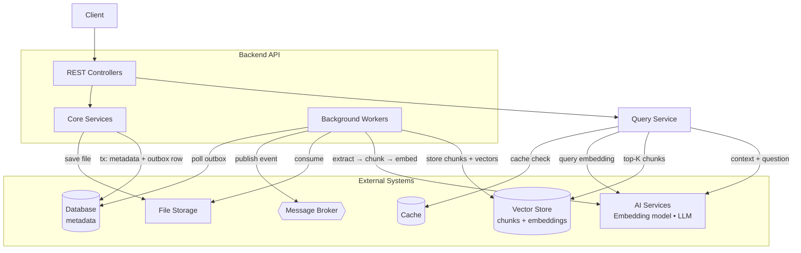

# ManualMate System Design

## Key Flows

- **Ingestion (async):** file upload → save → transactional outbox → broker → worker extracts, chunks, embeds, stores vectors
- **QA (sync):** question → cache → miss → embed question → retrieve top-K chunks → LLM answers → cached
