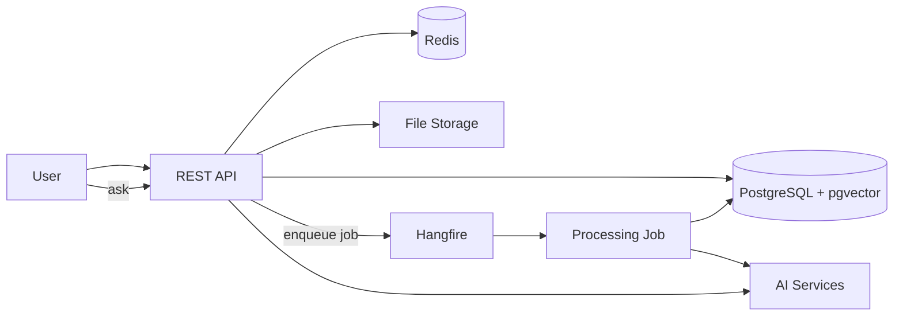

# ManualMate System Design

## Key Flows

- **Ingestion (async):** upload → save item + file → enqueue Hangfire job → job extracts, chunks, embeds, stores vectors
- **QA (sync):** question → Redis cache → miss → embed question → top-K chunks from pgvector → LLM answers → cached
