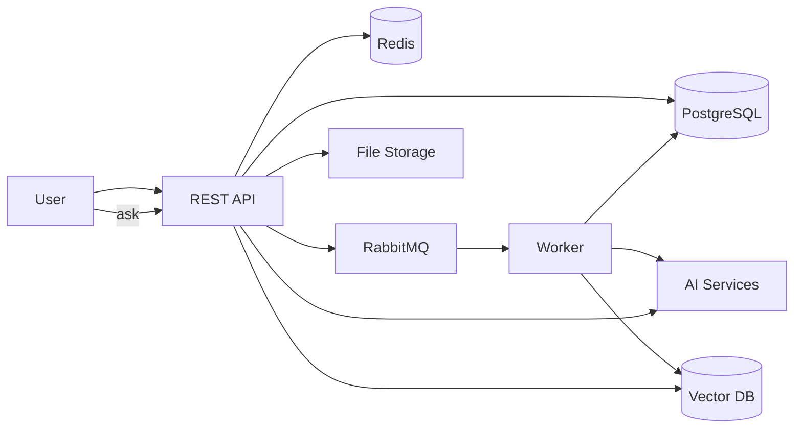

# ManualMate System Design

## Key Flows

- **Ingestion (async):** upload → save file → transactional outbox → RabbitMQ → worker extracts, chunks, embeds, stores vectors
- **QA (sync):** question → Redis cache → miss → embed question → top-K chunks from Vector DB → LLM answers → cached
